# Coqui Crypto app review and Deep Research handoff

Reviewed October 9, 2026 (America/Phoenix). Source baseline: `487431cb04ff93213c065bcd1c412968c3fbd1b4`, branch `feature/news-intelligence-phase4`, version `0.1.0-beta.16` candidate. Review completed by kokin with Codex.

## Overall assessment

Coqui has a substantial foundation: market charts and depth, connected portfolio visibility, paper execution, strategy research, risk controls, immutable evidence, news analysis and optional AI explanations. Its largest weakness is the distance between having those capabilities and making them reliably usable and verifiable in an ordinary session.

The next investment should be truthful state handling, guided readiness, operational validation and research provenance. Adding more indicators, providers or models before resolving those gaps would enlarge a product whose most important user questions remain difficult to answer: **What is working? Why is this blocked? What should I do next? Which result is valid for this exact strategy and dataset?**

This is a review and a research brief. It does not implement repairs, approve a release, register a study, authorize connected-account actions, or establish profitable performance.

## Scope and confidence

Two independent source assessments covered interface/task design and engineering/evidence gaps. Fresh captures used the existing production-renderer Electron visual-review harness in disposable, migrated profiles. Screens show disconnected/empty states and explicitly synthetic news evidence. Public historical candle reads occurred in terminal captures; these are display context, not proof of live-stream health. No personal credentials were entered, real profiles modified, paper orders submitted or study dates changed.

The capture used existing compiled desktop output alongside the inspected source baseline; a fresh rebuild was not performed. Initial pnpm execution attempted automatic dependency checking and stopped because network access/noninteractive installation was unavailable. Direct Electron invocation initially aborted in the sandbox, then succeeded with native access. Captures are useful interface evidence, not a new exact-revision release certification.

Targeted verification passed **4 files / 50 tests**: news rollout, news providers, research integrity governance and terminal market depth. The static Impeccable detector ran successfully and returned zero findings. Neither result negates the source defects below. Full verification, installed-package testing, screen-reader testing, real-host performance tracing and connected-account verification were not repeated.

Classification:
- **Confirmed source defect:** a specific implementation path produces misleading or incorrect behavior.
- **Confirmed product gap:** an existing requirement or workflow lacks usable support.
- **Verification gate:** implementation exists, but required operational evidence remains open.
- **Opportunity:** a proposed improvement whose value needs research or task testing.

Priorities are relative: **P1** before wider use or stronger reliability claims; **P2** substantial usability/evidence improvement; **P3** optional expansion. No new financial-loss or execution-authority bypass was demonstrated.

## Current capabilities and what to preserve

- **Markets:** completed-bar charts, drawing tools, indicators, comparison/layout controls, watchlists, order book and recent trades. Preserve separate display and decision timestamps.
- **Portfolio:** Coinbase/Robinhood read-only visibility, allocation, tax-lot/accounting and reconciliation screens. Preserve missing-value semantics and exact-decimal accounting.
- **Paper:** internal paper ledger, proposal review, orders/performance, separate Alpaca paper experiments and recovery controls. Preserve uncertainty blocks, deterministic order identities and manual Resume.
- **Research:** immutable datasets/artifacts, negative findings, trial accounting, eligibility and prospective/holdout governance. Preserve “no valid result” outcomes.
- **News:** bounded provider collection, canonical resolution, deterministic tone/event analysis, syndication grouping, point-in-time features, immutable archive exports and four diagnostic study horizons. Preserve coverage-unknown and actual-availability checks.
- **Operations and safety:** profile-scoped host/scheduler evidence, risk stages, safety stop and diagnostics. Preserve visible paper/read-only boundaries.
- **Advisor:** local facts and optional bounded cloud explanations with separate provider credentials. Preserve no execution authority and explicit evidence scope.

## Repairs and gaps ranked by urgency

### F01 - Profile failure can become endless loading
**P1 | Confirmed source defect | High confidence**

TerminalWorkspace returns “Loading profile…” whenever the profiles channel is anything except ready. That includes failed, blocked and unknown responses, so an unavailable profile is presented as a loading operation indefinitely.

Evidence: `apps/desktop/src/renderer/app/TerminalWorkspace.tsx:73-76`. The key condition is `if (profiles.kind !== 'ready')`.

Repair: render the actual channel state and a safe retry/open-diagnostics route. Retain actionable issue codes without dumping internal implementation details into user copy.

Acceptance: loading, refusal, unknown and transport failure have different visible outcomes; a failed profile never leaves the user staring at an unqualified spinner/loading message.

### F02 - Onboarding promises a readiness guide that Overview does not render
**P1 | Confirmed product gap | High confidence**

Onboarding tells users that Overview will keep a readiness guide visible until the first paper decision. ReadinessGuide has no renderer consumers, and Overview currently aliases TerminalWorkspace. Fresh terminal captures show charts and assets, with no persistent next-step guide.

Evidence: `Onboarding.tsx:112`, `Overview.tsx:1`, `ReadinessGuide.tsx`, `TerminalWorkspace.tsx:41-69`; screenshots 01-03.

Repair: restore a compact current-blocker/next-action module, including how to resume optional setup. Keep public market exploration usable without requiring a personal exchange key.

Acceptance: a new disconnected user can identify the next useful step from Terminal; completing or skipping a step updates the guide accurately; the guide does not imply that all research prerequisites are met.

### F03 - Cold-load onboarding focus management likely never attaches
**P1 | Source-backed defect candidate | High confidence in mechanism; keyboard reproduction pending**

Onboarding calls useDialogFocus before returning null while its channels load. The hook exits when its ref is null and depends only on the stable ref object. When the dialog appears later, the effect does not rerun. This can leave Tab containment, Escape dismissal and focus restoration inactive.

Evidence: `Onboarding.tsx:47-53,71-72`; `use-dialog-focus.ts:9-28`. Screenshot 01 establishes the visible modal, not its keyboard behavior.

Repair: mount a separate focus-managed dialog when visible, or bind the effect lifecycle to visibility and the actual element.

Acceptance: in a genuinely cold session, Tab/Shift+Tab stay within the modal, Escape uses the intended skip policy, and closing returns focus predictably. Test reopening and profile changes. W3C's modal pattern supplies the expected behavior [S1].

### F04 - Name setup advances without confirmed persistence
**P1 | Confirmed source defect | High confidence**

saveName awaits setPerson.run and then advances unconditionally. The command hook resolves its Promise after a refused result while recording failed/blocked/unknown state. The name screen does not show that failure.

Evidence: `Onboarding.tsx:76-78,97`; `query/use-command.ts:47-67`.

Repair: advance only after explicit success; show a recoverable error or uncertainty message and retain the entered value.

Acceptance: injected refusal or unknown outcome does not advance or claim setup was saved; successful persistence advances once.

### F05 - Unavailable notifications can look like no actionable evidence
**P1 | Confirmed source defect | High confidence**

NotificationCenter substitutes empty arrays when alerts or activity are not ready. It then displays “No unread or actionable evidence” when the resulting list is empty. A failed evidence source can therefore look reassuringly quiet.

Evidence: `StatusRail.tsx:71-85`.

Repair: distinguish loading, partial availability, failure and confirmed empty state. Notification count is a bounded recent preview, not a complete incident total.

Acceptance: a failed source is identified even if the other source succeeds; “none” appears only when the relevant reads succeed and contain no matching items.

### F06 - A retired forward study can still be labeled collecting
**P1 | Confirmed status-model gap | High confidence**

The fresh empty-profile Research screen says “collecting” and 0/365 days. Startup persists SHIPPED_FORWARD_EDGE_PLAN. readForwardEdgeStatus derives collecting from a stored plan with no result, without checking current strategy compatibility or recent eligible observations. Elsewhere the profitability gate explicitly rejects the retired strategy's identity.

Evidence: `main/composition.ts:144`; `main/forward-edge-runtime.ts:37-55,362-370`; screenshot 08. Current roadmap evidence identifies the old study as retired for identity mismatch.

Repair: distinguish historical registration, incompatible/retired, eligible-but-idle, actively collecting and complete. Display compatible strategy identity, last valid observation and the reason eligibility is absent. Do not silently register a replacement or rewrite historical evidence.

Acceptance: an incompatible legacy plan never appears to be collecting evidence for the current executable. Installing the app alone does not imply an owner-approved new prospective study.

### F07 - Paper proposal review omits quantified consequences
**P2 | Confirmed requirement gap | High confidence**

Review shows asset, side and notional plus generic gate descriptions. Estimated costs and portfolio/risk effect are absent, although the UI contract requires them before confirmation. The proposal schema also lacks those preview fields.

Evidence: `PaperProposalReview.tsx:67-82`; `packages/contracts/src/schemas/paper-execution.ts:39-44`; `docs/UI-UX.md:102-104`.

Repair: bind authoritative cost estimates, exposure/drift changes, freshness, source and expiry to the proposal revision/hash. Label estimates and unavailable values; recheck gates at submission.

Acceptance: the user sees before/after allocation and the actual modeled cost components or an explicit unavailable state. Review cannot approve stale preview evidence without revalidation.

### F08 - Real-data latency remains unresolved
**P1 | Verification gate with measured hotspot | High confidence in gap; cause unproven**

Frontend optimization evidence is strong, but the reported real-data scrolling/click/chart lag was not reproduced by deterministic fixtures. Depth processing materializes and sorts large books synchronously in the main process. A historical synthetic benchmark measured roughly 53-65 ms for 50,000 levels on one side; this is a suspect, not an identified cause of the user's lag.

Evidence: `main/coinbase-microstructure.ts:88-91`; `main/market-depth.ts:36-48`; `docs/studies/frontend-performance-2026-10-08.md:37,81`. Linear: COQ-5, COQ-6, COQ-7.

Next: capture renderer trace, main CPU/event-loop delay, IPC latency, book size and scheduler overlap during actual stutter. Compare the same workload after any change. Electron advises avoiding main/renderer thread blocking [S2].

Acceptance: measured reproduction and attribution; comparable improvement; exact aggregation and data freshness preserved; cold start and a long-running session measured separately.

### F09 - News is implemented but useful live ingestion remains unproven
**P1 | Verification gate and diagnostics gap | High confidence**

Dated Main validation retained zero articles after an invalid response and timeout; required Coinbase canonical identities were missing. That does not establish the provider's current state. Fresh news captures use a clearly synthetic item. Provider health emphasizes transport successes, which are not the same as retained usable evidence.

Evidence: `docs/studies/news-intelligence-rollout-2026-10-09.md:40-49`; `main/news-handlers.ts:27-40`; `packages/services/src/news/runtime.ts:70-102`; screenshots 09-10. Linear: COQ-19 through COQ-22.

Repair/improve: expose last useful ingestion, retained/rejected counts, sanitized rejection reason, next scheduled opportunity and specific mapping readiness failures. Complete reviewed identity setup and observe naturally due provider attempts under existing host/rights/quota rules.

Acceptance: a real retained article resolves to a reviewed canonical instrument with genuine availability provenance; transport-only success never appears as content success. Metered-provider retention remains an explicit gate.

### F10 - News research status is not linked to its report
**P2 | Confirmed provenance/usability gap | High confidence**

Research displays a scalar not_run/insufficient_evidence/evaluated status. The CLI writes that string into a setting, but the desktop view does not bind it to the immutable report hash, completion time, datasets or four per-horizon reasons. Archive-mode research without a database argument may leave the desktop status unchanged.

Evidence: `NewsPanels.tsx:54-56`; `main/news-handlers.ts:32-35`; `scripts/research-news.mjs:45-60`; screenshot 08.

Repair: persist a validated immutable report reference and expose per-study eligible rows, missing instruments/windows, source/cost/version identity, completion time and export/open controls.

Acceptance: every displayed evaluated/insufficient result identifies its exact report; stale or unrelated settings cannot summarize a different study. Evaluated means computation completed, not profitable, validated or promoted.

### F11 - Connected paper behavior needs actual end-to-end evidence
**P1 | Verification gate | High confidence**

Recovery, broker evidence, deadlines and manual Resume are implemented and tested. Local tests do not close intended-host keychain, real Alpaca paper partial fill/fee/cancel, ambiguous order lookup, restart, lease ownership and reconciliation requirements.

Evidence: Linear COQ-12, COQ-14 and COQ-15; current roadmap. Screenshot 07 is an empty-state review, not a broker exercise.

Next: an owner-authorized dedicated paper-account exercise with redacted evidence and exact build identity. Coinbase real-key View-only validation remains owner-deferred.

Acceptance: uncertainty blocks new actions; reconciliation does not duplicate orders; pause/Resume and restarts preserve authority; actual fills/fees reconcile. Keep live execution disabled.

### F12 - Recovery documentation understates the data model
**P1 | Confirmed documentation gap; P2 interface opportunity | High confidence**

INSTALL says “One SQLite file” and recommends copying or deleting it. The app now has profile data and verified backup machinery; beta.16 warns about migration-compatible recovery. Settings lacks a dedicated Backup and Recovery category.

Evidence: `docs/INSTALL.md:89-112`; `packages/storage/src/sqlite/connection.ts:108`; `packages/storage/src/profiles/backup.ts:222`; `docs/RELEASE-NOTES-beta.16.md:13`; `Settings.tsx:17-25`.

Repair: document actual profile locations, application/schema compatibility, verified backups, archives and the separate OS credential store. Add guided backup verification and restore into a separate profile rather than overwriting unverified evidence.

Acceptance: a disposable restore recovers profile/evidence integrity with a compatible build; instructions explain what is and is not restored. This finding does not establish that existing automatic backups fail.

### F13 - Dataset and strategy qualification remain open
**P1 | Verification/governance gates | High confidence**

Historical evidence records no Coinbase archive rows because source/provenance access failed, a missing Kraken ETH day, and rejection of a spread-floor comparison before registration. The old forward study was retired for identity mismatch. These records cannot be replaced by another venue's data or synthetic history.

Evidence: `docs/studies/market-acquisition-2026-10-03.md`; `trendvol-spread-floor-v1-2026-10-03.md`; `paper-forward-run-2026-08-22.md`; `docs/audit/astra-algorithm-audit-2026-10-03.md`. Linear: COQ-10, COQ-16, COQ-17, COQ-18.

Next: inspect present coverage and executable/data/cost identity; show blockers in Research; make any new registration an explicit owner decision. No positive live/paper edge is established by this review.

Acceptance: exact identities and eligibility are recorded; valid observations accumulate in real time; development selection is frozen before untouched holdout evaluation; candidate “none” is supported.

### F14 - Current status and release identity need consolidation
**P2 | Confirmed documentation gap and verification gate | High confidence**

README/PLAN contain older study/current-state language and counts. Dated handoffs mix historical uncommitted work with now-committed implementation. Beta.16 is a candidate; passing CI or packaging does not mean review, merge or publication. A user-facing installed-version/schema/recovery summary would help.

Evidence: `README.md`; `docs/PLAN.md:20-27`; `docs/HANDOFF-current-state-2026-10-03.md`; `docs/RELEASE-NOTES-beta.16.md`. Linear: COQ-8, COQ-9, COQ-13.

Repair: maintain one current-status index with links to immutable historical reports. Add About/Release with version, channel, schema, compatible recovery guidance and verified release notes. Verify actual branch protections separately.

Acceptance: source, candidate artifact, reviewed/merged revision and published release are distinct; stale documentation points to its successor without erasing evidence.

## Features that could improve substantially

**Terminal hierarchy and continuity.** At 1920 px, algorithm/evidence context is visible; at 1280 px it sits behind a drawer while the chart dominates. Keep a short stand-down reason and next action visible at laptop widths. Preserve the terminal design and advanced chart tools. Screenshots 02-03 show the difference. Test “explain the current decision and why no order occurred,” not merely navigation speed.

**Research as a usable lifecycle.** Connect verified dataset selection, registration, trial ledger, development, candidate/none freeze, prospective progress and final evaluation in the desktop. Much of the governance backend exists; the desktop currently exposes fragments and CLI-oriented prerequisites. Every stage should show eligibility, exact identity, blockers and a safe next action.

**Operational health as one actionable view.** Combine feed age, scheduler/lease health, missed expected slots, broker uncertainty, reconciliation, incident severity and backup readiness. The existing agent-themed Operations cards and evidence feed can remain drill-downs. The primary view should answer “What needs attention now?” A missing historical observation must remain missing.

**News as an inspectable research source.** Add canonical-asset/event/provider/time filters, syndication-group drill-down, clear source navigation and explainable tone limitations. Research whether bounded pagination/checkpoints can improve coverage within quota/rights limits. Do not interpret first-page emptiness as “no news happened,” or publisher diversity as independent corroboration.

**Performance interpretation.** Show actual sample length, missing days, fees/spread/slippage and compatible benchmarks alongside ratios and curves. The empty Performance screen already avoids inventing history. Extend that honesty to sparse/nonempty results and uncertainty, rather than filling the panel with headline metrics.

**Progressive disclosure and plain copy.** Research and Operations use terms such as trial bound, persisted worker and exposure scale. Keep precise detail available, but put the practical meaning and next action first. At 200% zoom the shell reflows but uses much of the first viewport; test task completion and repeated scrolling with keyboard/screen-reader users before changing compact layout.

## New additions worth researching

1. **Readiness and health center (highest value):** a single checklist for safe exploration, account visibility, paper readiness and research qualification, each with separate criteria. Reuse current readiness channels; never collapse these into a universal green “ready.”
2. **Evidence export and deterministic decision replay:** a redacted bundle of exact build/data/cost identities, decisions, outcomes and diagnostic timings; replay explains why a decision happened without submitting orders.
3. **Guided experiment workspace:** immutable plan creation, dataset/identity checks, trial accounting, candidate/none freeze and elapsed coverage calendar. Reuse existing governance and obtain owner approval for registration.
4. **Verified backup/restore and About center:** leverage current storage backup logic; verify restoration before presenting a backup as usable.
5. **Read-only contribution planner:** Allocation explicitly defers this. Compare adding cash with sell/buy rebalancing, cost/minimum-trade constraints and remaining drift. Use authoritative estimates and separate it from execution.
6. **Tax-lot loss estimate and coverage review:** Tax explicitly defers this, while exact-decimal losing-lot calculations exist. First expose missing basis and assumptions. Any jurisdiction-specific treatment requires current authoritative research and qualified review; no tax conclusion is made here.
7. **Opt-in meaningful alerts and research notebook links:** notify on actual health changes, unresolved uncertainty or eligible research transitions; attach rationale and evidence to Obsidian/Linear handoffs. Avoid periodic noise and automatic promotion.

Lower priority until justified: more indicators, extra AI providers, larger strategy/model searches, additional exchanges, cloud sync/mobile companions. Expanding strategy search consumes trial budget and increases overfitting risk. Live execution is outside this review's proposed scope.

## Suggested sequence

**Pass 1 - Truthful states and recovery:** F01-F06; repair the installation/recovery instructions in F12. These are primarily local implementation tasks and do not need a broad competitive study to establish that the behavior is wrong.

**Pass 2 - Prove existing operation:** F08, F09, F11, F13 and release safeguards. Gather actual evidence with owner-authorized accounts and exact revisions. Preserve unmet rights, review and elapsed-time gates.

**Pass 3 - Make evidence usable:** F07, F10, terminal summaries, the guided research lifecycle and operational health. Reuse immutable records and validated IPC.

**Pass 4 - Select additions:** choose from the new-feature shortlist using verified user value, dependency cost and research findings. Do not commit dates or estimates until code scope is defined.

## Screenshot walkthrough

All images below were captured in this review run and inspected before acceptance. They show selected viewports, not every scroll position or every interaction. Except public historical chart reads, profiles are disposable and disconnected; news is synthetic. Empty screens are expected fixtures, not proof that the user's personal installation has no data.

1. **Setup modal - repair candidate.** Clear optional/safety copy; conditional focus lifecycle needs cold-session testing.
2. **Terminal at 1280 px - needs hierarchy improvement.** Chart tools dominate; algorithm context is behind a drawer and readiness guide is absent.
3. **Terminal at 1920 px - stronger context.** Evidence/risk sidebar is visible; compatible timestamps and stand-down explanation still need task testing.
4. **Connections - clear boundaries, setup friction.** Read-only/OS keychain and separate Alpaca paper semantics are visible; connection success was not tested.
5. **Portfolio holdings - healthy empty state.** Explicit unavailable portfolio and useful connection link.
6. **Reconciliation - needs next action.** Honest “never run” state; no direct recovery/start guidance in the captured panel.
7. **Paper overview - mixed readiness.** Clear blocked preparation and settings links; prominent Prepare action remains visible above the blocker.
8. **Research - needs lifecycle/status repair.** Empty artifacts are truthful, but legacy study appears collecting; news status is too thin.
9. **News details - functional synthetic evidence.** Tone/provenance/unresolved candidate are visible; filtering and report/source drill-down could improve.
10. **News diagnostics - needs actionable content health.** Transport counts and command-based mapping prerequisite are visible; useful-ingestion evidence is absent.
11. **Operations - honest but fragmented.** Six unavailable read models explain missing evidence; a consolidated next-action summary would help.
12. **Paper Performance - healthy missing-history handling.** No invented curve; improve sample/context presentation when real records exist.
13. **Risk - healthy stand-down disclosure.** Explicit insufficient observations and separate snapshot counts; dense explanatory content needs task testing.
14. **Research at 200% high contrast - reflows, usability unproven.** Navigation wraps; header consumes much of the viewport. No full accessibility compliance claim.

## Deep Research assignment

Copy the separate prompt file or the text below into GPT Deep Research and attach this PDF. The PDF contains the findings and screenshots, so private GitHub/Linear access is not required.

### Prompt to give GPT Deep Research

You are reviewing Coqui Crypto, a local Electron/React crypto research and paper-trading workstation. Analyze the attached October 9, 2026 app review as the baseline, then produce a source-cited product and engineering decision brief that I can hand back to Codex for implementation planning.

The app already has market charts/depth, read-only Coinbase/Robinhood portfolio visibility, paper proposals and separate Alpaca paper experiments, immutable research/data evidence, risk controls, bounded news intelligence, and optional evidence-bound AI explanations. Live execution is hard-disabled. The inspected baseline is beta.16 candidate, commit 487431cb04ff93213c065bcd1c412968c3fbd1b4. Do not assume the candidate is merged/released or operational gates are closed.

Preserve the review's evidence classifications. Source findings are not all reproduced runtime defects; screenshots use disposable/disconnected profiles and synthetic news. Distinguish dated observations from current provider conditions. Challenge recommendations when evidence suggests a better approach. Do not invent private repository access, successful broker checks, valid strategy alpha, prospective start dates or elapsed coverage.

Research these questions in order:
1. What should a reliable, understandable readiness/error/recovery system look like for this workstation? Specify loading/unknown/blocked/failed/empty/partial/stale semantics, cold-modal accessibility and laptop-width decision hierarchy.
2. What is the best diagnostic plan for real Electron market-data lag? Compare exact incremental depth aggregation, workers and bounded IPC; recommend measurements and decision thresholds before an architecture change.
3. How should news ingestion, canonical resolution, coverage, source rights and point-in-time study provenance be exposed? Compare realistic free/low-cost data approaches using current official provider documentation; differentiate useful retained evidence from HTTP success and observed absence from unknown coverage.
4. What research workflow prevents identity drift, selection bias, repeated holdout use and false promotion? Recommend interpretable baselines, cost stress, trial accounting, uncertainty, candidate/none freeze and elapsed coverage reporting. More models must not substitute for valid data.
5. What verification would establish trustworthy connected paper execution, restart/reconciliation and backup restoration? Use current official Electron, SQLite and Alpaca/Coinbase/Robinhood documentation where applicable. Preserve owner authorization and read-only/paper separation.
6. Which additions offer the highest value for a single local operator: health/readiness center, evidence export/replay, guided experiments, contribution planner, tax-lot coverage/estimates, notebook links or alerts? Compare selectively with relevant official product documentation; do not produce a generic trading-app feature list.

Required output:
- An executive recommendation and a revised ranked backlog mapping every accepted/rejected/deferred recommendation to F01-F14 or a new stable ID.
- For each item: problem, user task, evidence and confidence, recommended behavior, alternatives/tradeoffs, dependencies, rough relative complexity (S/M/L, not invented calendar estimates), failure/recovery states and testable acceptance criteria.
- A capability comparison that distinguishes missing features from existing-but-unproven implementation.
- Separate immediate repairs, operational verification, substantial improvements and optional additions.
- A specific validation plan: cold onboarding keyboard/screen-reader, errors and partial reads, realistic performance traces/soak, connected paper recovery, dataset identity/coverage and restored backup integrity.
- Current primary-source citations adjacent to claims, publication/access dates where relevant, and explicit uncertainty. Flag legal/provider retention questions for appropriate review without pretending this report grants rights.
- A proposed staged roadmap with dependency order, open owner/review/provider-rights/elapsed-evidence gates, and clear reasons to defer low-value complexity.
- A “Return to Codex” section: exact proposed tasks, acceptance checks, source assumptions that still need repository verification, and decisions requiring my approval. Do not write production code or register/promote research.

## How to return the research to Codex

Return the Deep Research report with this review or its F01-F14 identifiers. Ask Codex to verify each recommendation against the then-current checkout, reconcile it with existing Linear issues, and turn accepted recommendations into a dependency-ordered implementation plan. Findings should be revalidated after intervening changes.

Expected coding handoff for each task: stable finding ID; target modules; selected approach and rejected alternatives; testable acceptance; data/contract/migration implications; operational evidence needed; open owner/release gates; originating prompt. Review completion must never close the separate repair or research gates.

## Evidence references

Repository paths above are relative to Coqui-Crypto. The baseline is available at https://github.com/kokin-blip/Coqui-Crypto/commit/487431cb04ff93213c065bcd1c412968c3fbd1b4 if the reader has access. Local source inspection supports the code findings; external research should not pretend to have inspected inaccessible files.

Existing issue alignment: COQ-5/6/7 frontend/performance; COQ-8 current docs; COQ-9 branch safeguards; COQ-10/16/17/18 research identities/data/coverage/promotion; COQ-12/14/15 paper recovery and owner-gated verification; COQ-13 release; COQ-19/20/21/22 news. These issues retain their existing acceptance criteria and status. New repair recommendations have not been implemented or individually scheduled.

S1: [W3C WAI ARIA modal dialog pattern](https://www.w3.org/WAI/ARIA/apg/patterns/dialog-modal/), accessed October 9, 2026. Used only for modal keyboard behavior.
S2: [Electron performance guidance](https://github.com/electron/electron/blob/main/docs/tutorial/performance.md), accessed October 9, 2026. Used only for main/renderer blocking and measurement guidance.

## Prompt used

> Do a review of the app, tell me what we are lacking in, what current features need repair / need to be improved / can be improved substantially, what new things we could add, and what needs to be fixed.
> 
> Turn this in a review that I can then handoff to GPT deep research, after which the deep research is done, I can hand it back over to you.

Questions skipped: this deliverable is a research handoff; optional product choices are explicitly queued for Deep Research rather than blocking the review.

## Captured screenshots

### Screenshot 1 Setup modal

Clear optional and safety copy; cold-load focus management requires repair verification.

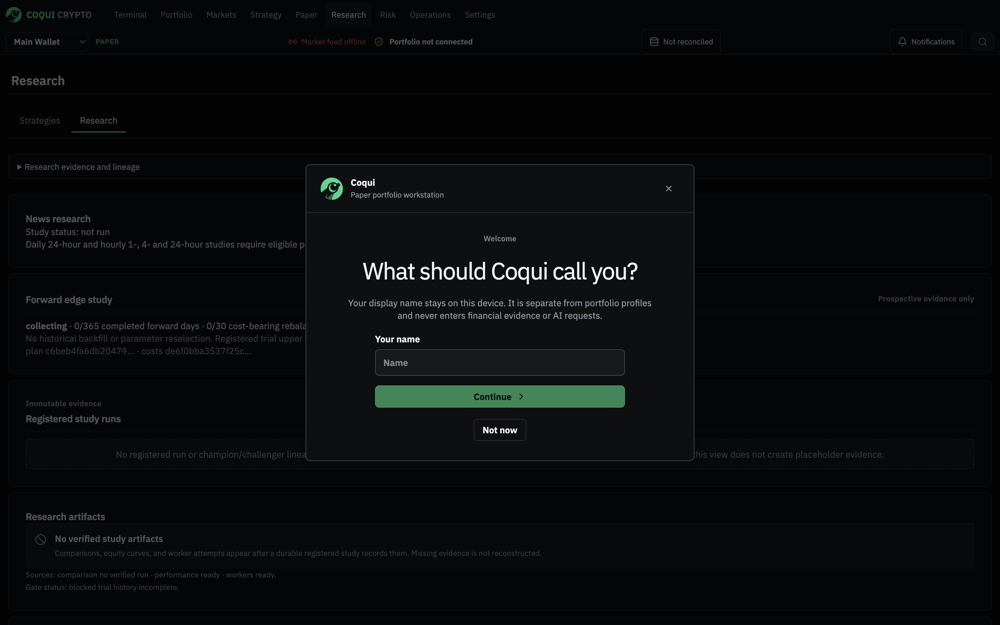

### Screenshot 2 Terminal at 1280 pixels

Algorithm context moves to a drawer; readiness guide is absent. Historical display candles do not prove live health.

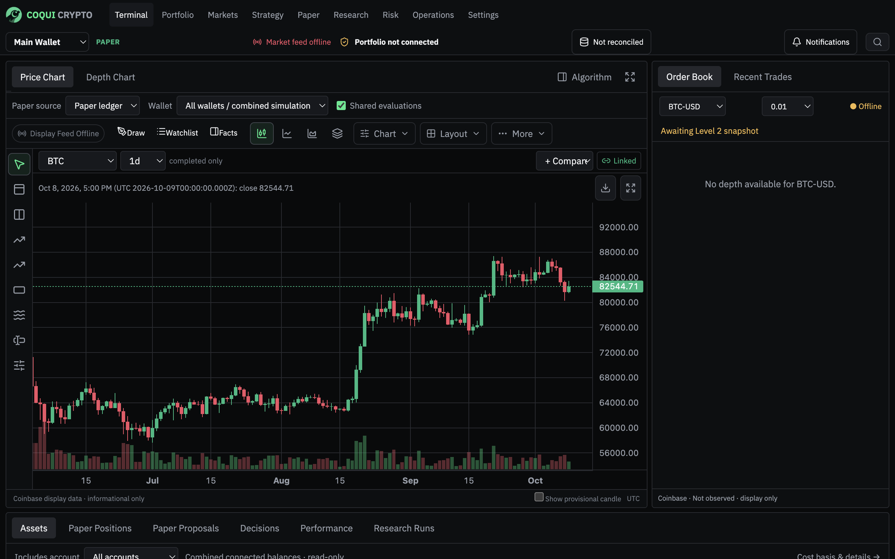

### Screenshot 3 Terminal at 1920 pixels

Evidence and risk sidebar is visible. Disconnected disposable profile; no valid strategy result is demonstrated.

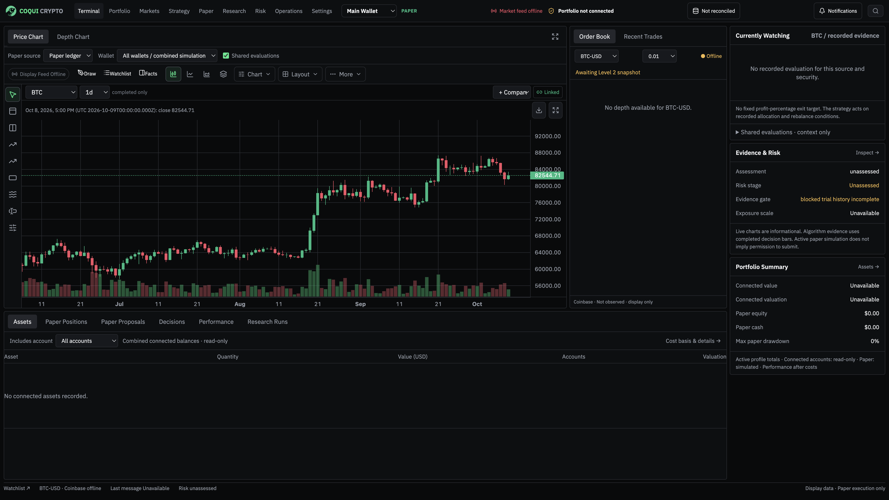

### Screenshot 4 Connections

OS keychain and read-only boundaries are explicit. Credential setup was not exercised.

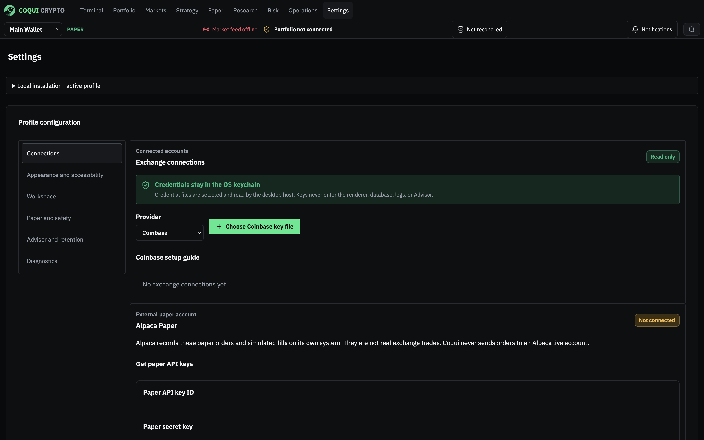

### Screenshot 5 Portfolio holdings

Honest empty state with an actionable connection link.

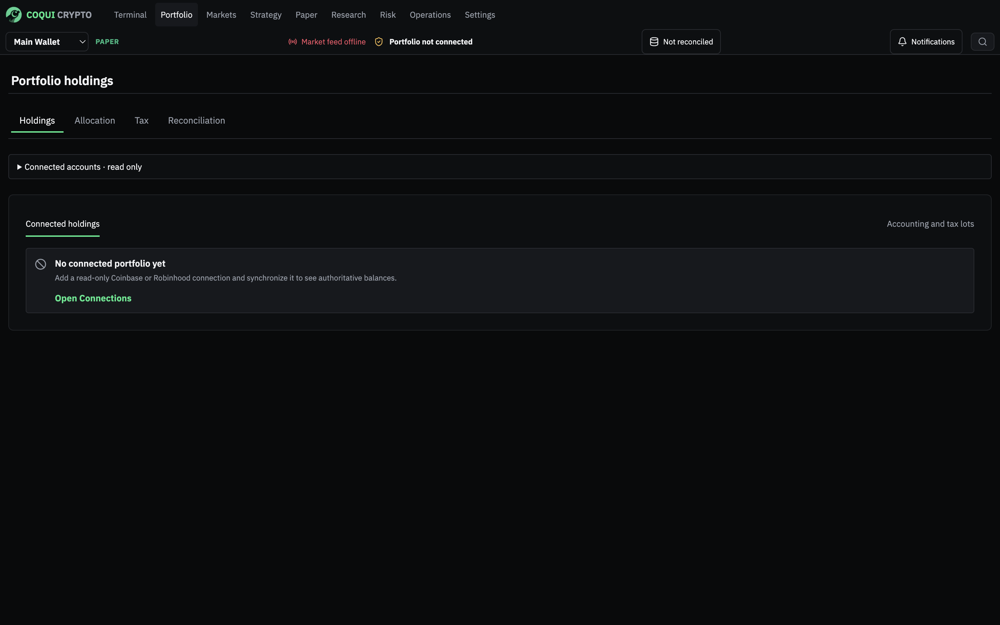

### Screenshot 6 Reconciliation

Never-run disclosure is accurate for the fixture; next-action guidance could improve.

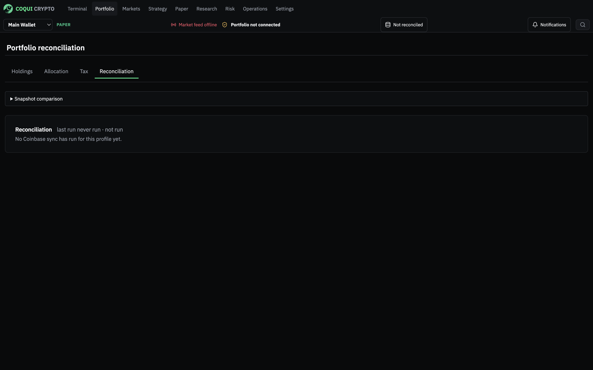

### Screenshot 7 Paper overview

Blocked preparation is visible beneath the Prepare action. No broker orders were submitted.

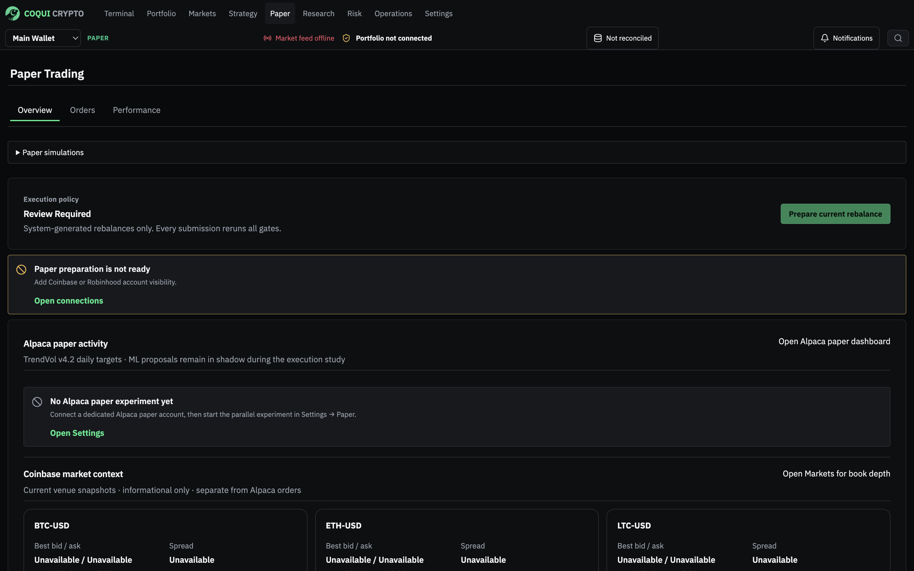

### Screenshot 8 Research

Legacy plan is labeled collecting; news status lacks a report reference. Empty artifacts remain explicit.

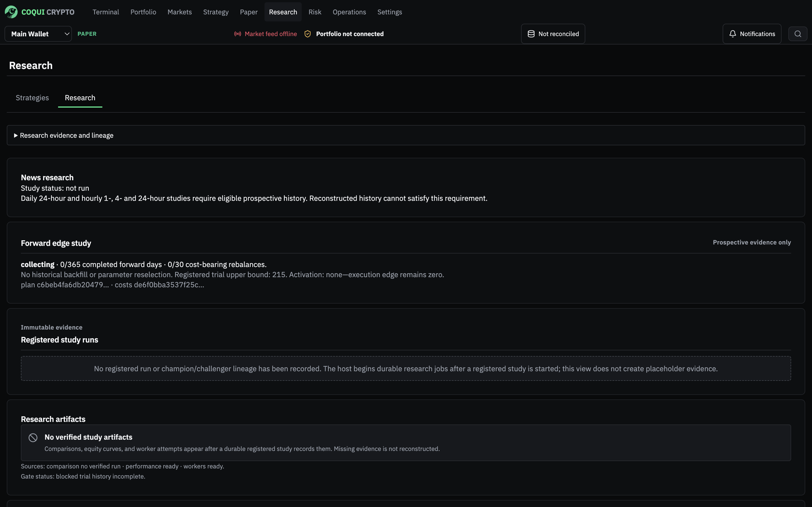

### Screenshot 9 News detail

Explicit synthetic article, resolved BTC and unresolved Ethereum. This does not establish real ingestion.

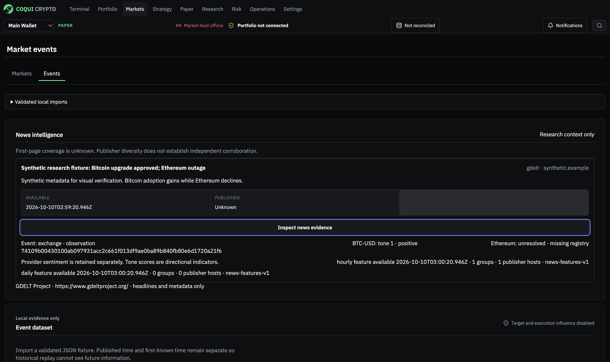

### Screenshot 10 News diagnostics

Transport counters and command-based mapping prerequisite; useful ingestion needs separate evidence.

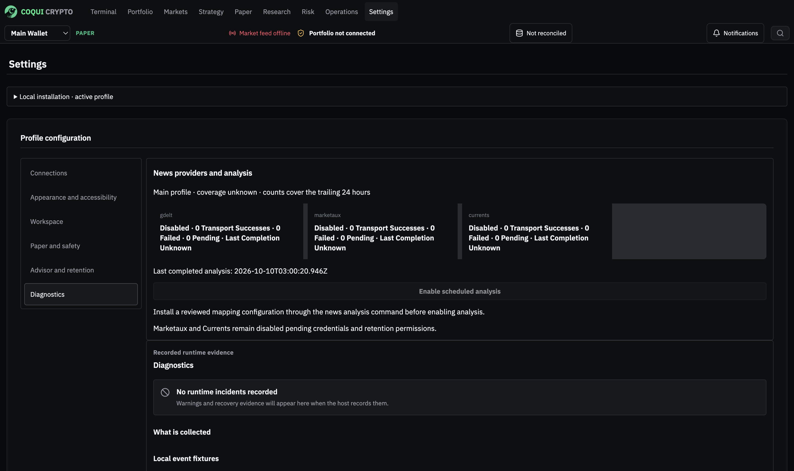

### Screenshot 11 Operations

Six bounded read models explain missing evidence; a unified current blocker would reduce scanning.

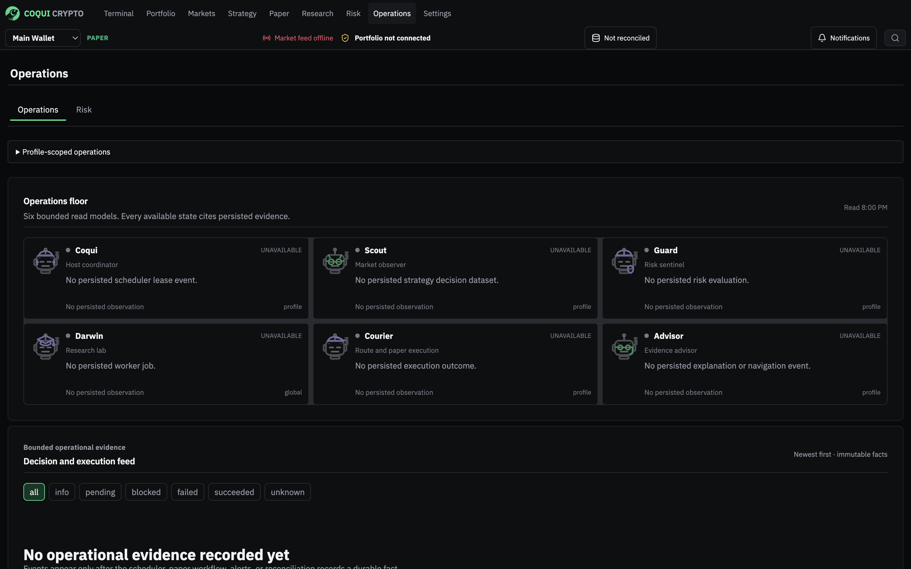

### Screenshot 12 Paper performance

No invented curve or ratios. Actual sample context should remain visible for nonempty histories.

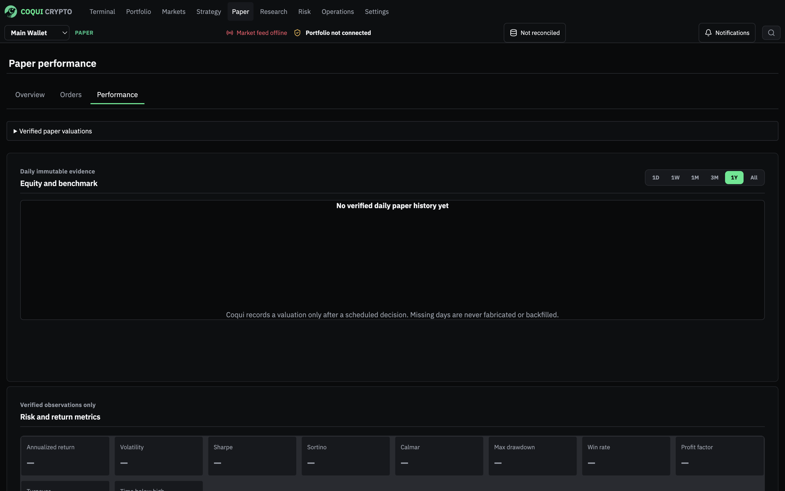

### Screenshot 13 Risk

Insufficient history and stand-down are explicit; guardrail and performance histories are distinguished.

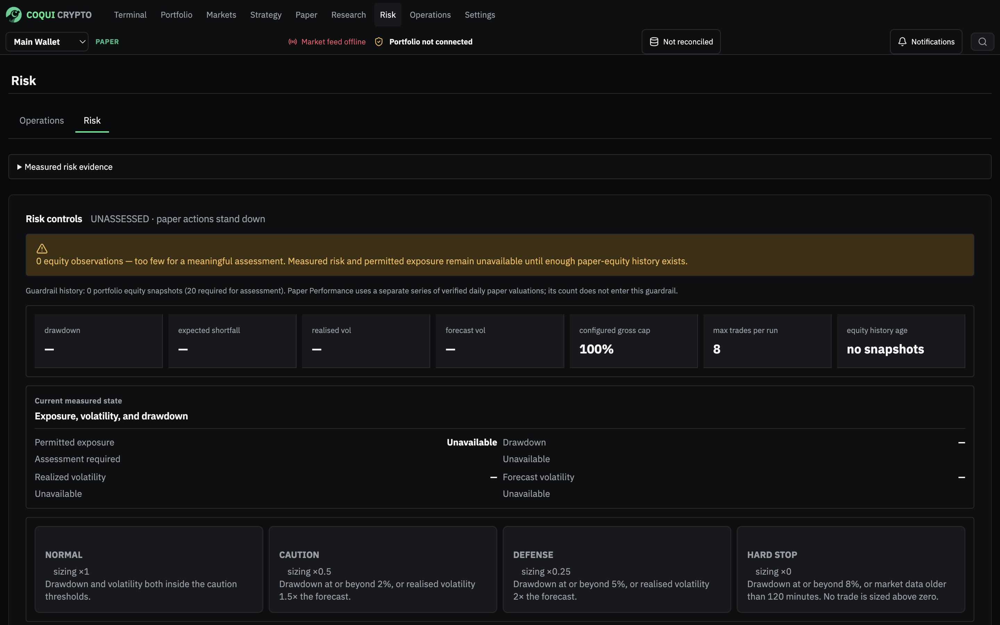

### Screenshot 14 Research at 200 percent zoom

High contrast reflows, but shell and navigation consume much of the first viewport. Keyboard and screen-reader tasks remain unverified.

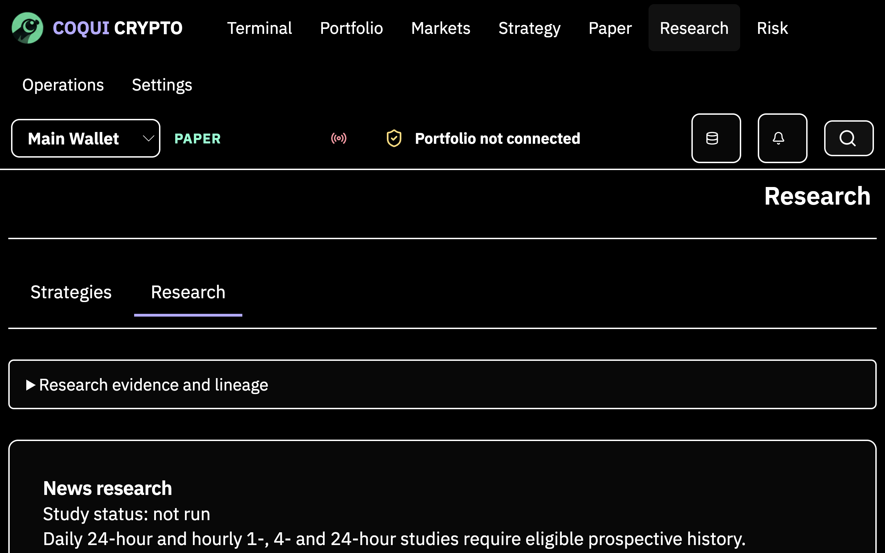

